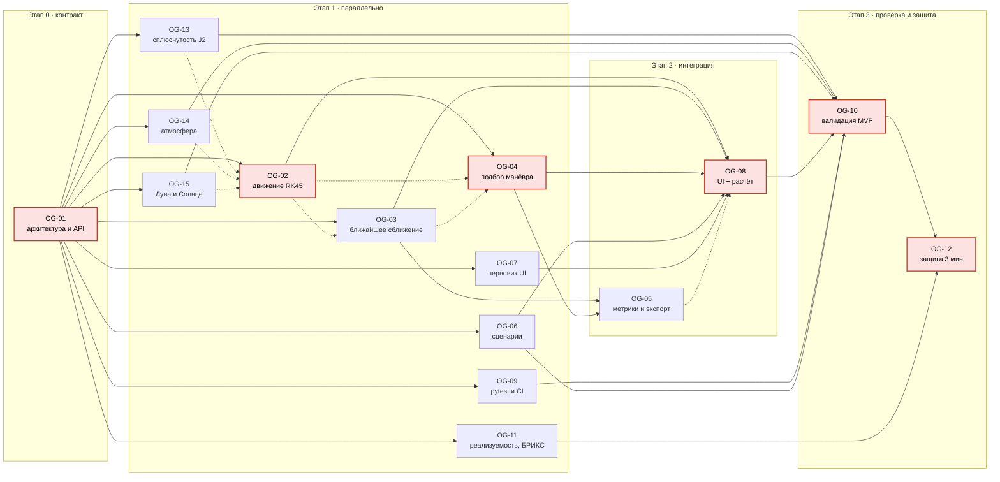

# Варианты распределения работы на 5 человек

Предложение для обсуждения командой; итоговое решение фиксируется в docs/PLAN.md и issues.
Основа: портфолио «OrbitGuard, 5 слайдов», docs/PLAN.md, docs/BACKLOG.md (OG-01…OG-12).

## Кратко об условии (из портфолио)

- Продукт: симулятор, который прогнозирует сближение двух объектов (спутник и мусор)
  и подбирает безопасный импульсный манёвр с минимальным Δv.
- Физика: в портфолио двухтельная задача и RK45; по решению команды добавлены J2, атмосфера, Луна и Солнце (docs/PHYSICS.md).
- Алгоритм: поиск момента ближайшего сближения → перебор импульсов → выбор минимального Δv,
  обеспечивающего заданную безопасную дистанцию.
- Результат к защите: работающий MVP с воспроизводимыми сценариями, графиками Plotly, интерфейсом Streamlit.
- Метрики: минимальная дистанция, Δv, оценка топлива (только при заданных массе и Isp), время манёвра.
- Пять участников. Кто какую тему берёт, команда решает сама; на защите вклад каждого должен быть виден.
- Сроки: интенсив 23–26 ноября, доработка и защита 29 ноября (3 минуты).

## Зависимости задач

Сначала согласуются интерфейсы данных (OG-01). Затем параллельно: модель, поиск сближений,
манёвр, тестовая инфраструктура и черновик интерфейса. Сквозная интеграция OG-08 зависит
от расчётных модулей. Календарный план — в docs/PLAN.md.

Сплошная стрелка — задачу нельзя начать без предыдущей.
Пунктир — можно начать раньше, но проверка с реальным кодом только после предыдущей.



Красным выделен критический путь: OG-01 → OG-02 → OG-04 → OG-08 → OG-10 → OG-12.
Главное условие параллельности — OG-01 (контракт и пример данных) готов в первый же день.
После этого каждый работает против контракта и маленьких фикстур, не дожидаясь чужого кода.

---

## Темы на выбор

Кто какую тему берёт и кто ревьюит, команда решает сама и фиксирует в issues.

| Тема | Задачи | Свои файлы | Что делать до готовности зависимостей |
|---|---|---|---|
| 1. Модель орбит и общий API | OG-01, OG-02, OG-13 (J2) | models.py, propagation.py, forces/gravity.py, docs/contracts.md | — (стартует первой) |
| 2. Поиск сближения и метрики | OG-03, OG-05 | conjunction.py, metrics.py | Тестировать на прямолинейных траекториях r(t)=r0+v·t |
| 3. Подбор манёвра и обоснование | OG-04, OG-11 | maneuver.py, docs/feasibility.md | Перебор кандидатов с подставляемой функцией propagate; OG-11 параллельно |
| 4. Интерфейс | OG-07, OG-08 | app.py, ui/ | UI на фикстуре из OG-01, помеченной «демо-данные» |
| 5. Сценарии, тесты и защита | OG-06, OG-09, OG-10, OG-12 | scenarios.py, .github/, tests/integration, docs/validation.md, docs/demo.md | CI и каркас тестов сразу после OG-01 |

Силы OG-14 (атмосфера) и OG-15 (Луна и Солнце) — отдельные небольшие задачи в своих файлах
(docs/PHYSICS.md). Их удобно взять тем, у кого в первые дни меньше нагрузки, например темам 2 и 5,
пока они ждут интеграции.

Замечания по нагрузке:
- Тема 1 — узкое место первых двух дней. Снижение риска: минимальная версия propagate
  (solve_ivp, ~30 строк) выкладывается вместе с OG-01, проверки доделываются в OG-02.
- Тема 5 самая загруженная в конце недели. Сценарии (OG-06) можно передать теме 1 после OG-02:
  построить опасное сближение — задача орбитальной механики (мусор задаётся обратным
  интегрированием от точки встречи).
- Тема 4 ждёт сквозного расчёта для OG-08; до этого работает на фикстурах.

## Способы организации

**По темам (рекомендуется).** Каждый владеет своими файлами; общие файлы (pyproject, models.py,
contracts.md) меняются только через OG-01. Минимум конфликтов в Git и понятный ответ «кто что сделал».

**Пары «автор + проверяющий».** Темы 1 и 5 в паре, темы 2 и 3 в паре, тема 4 отдельно.
Ревью идёт без ожидания, но пары легко начинают править файлы друг друга.

**«3 на код, 2 на качество и защиту».** Расчёт сближения и манёвра у одного человека,
метрики и валидация — у независимого проверяющего. Валидация честнее, но расчётная часть перегружена.

**Не рекомендуется: «каждый делает свой сценарий целиком».** Все правят одни и те же модули,
физика реализуется по-разному, за 4 дня это почти гарантирует конфликты.

---

## Примерный график по темам

| День | Тема 1 | Тема 2 | Тема 3 | Тема 4 | Тема 5 |
|---|---|---|---|---|---|
| 22 ноя | OG-01 + минимальный propagate | ревью OG-01 | ревью OG-01, старт OG-11 | макет экранов | каркас pytest |
| 23 ноя | OG-02, OG-13 | OG-03 | OG-04 на подставной propagate | OG-07 на фикстуре | OG-09 CI |
| 24 ноя | OG-06 сценарии | OG-03 → PR, старт OG-05 | OG-04 с реальными OG-02/03 | OG-07 → PR | тесты интеграции |
| 25 ноя | ревью, merge, интеграция сил | OG-05 | OG-04 → PR | OG-08 сквозной запуск | OG-10 на сценариях |
| 26 ноя | исправление дефектов | исправления | OG-11 → PR | OG-08 → PR, экспорт | OG-10 → PR, измерения для слайдов |
| 27–28 ноя | ответы по физике | ответы по сближениям | бизнес/БРИКС | заморозка UI, скриншоты | OG-12: текст, репетиция ≤3 мин, запуск на втором ПК |

OG-14 и OG-15 идут параллельно 23–24 ноября у тех, кто их возьмёт, и подключаются 25 ноября.
Каждый готовит слайд и ответы на вопросы по своей теме.

## Правила, без которых параллельность ломается

1. Ни одной строки алгоритмов до merge OG-01: сигнатуры, единицы (SI, ECI, секунды от t0), статусы.
2. Изменение контракта — только через issue OG-01 и docs/contracts.md, с упоминанием исполнителей зависимых задач.
3. Один issue — одна ветка `codex/issue-N-short-name` — один небольшой PR; чужие файлы не правятся.
4. Фикстуры для UI и тестов явно помечены как синтетические; на графиках защиты — только реальные расчёты.
5. Ежедневная короткая синхронизация: что смержено, что блокирует, чей PR ждёт ревью.

## Что каждый участник передаёт своему агенту

Ветка: личная (`ann`) или, если ветка общая, короткое название по сути задачи.

```text
Работаем в github.com/orbitguard-team/orbitguard.
Прочитай START_HERE.md и AGENTS.md. Выполни назначенный мне issue #N.
Проверь обсуждение и зависимости, создай свою ветку от main,
выполни критерии задачи и нужные проверки, открой PR с Closes #N
и запроси ревью у другого участника. Не делай merge.
```
