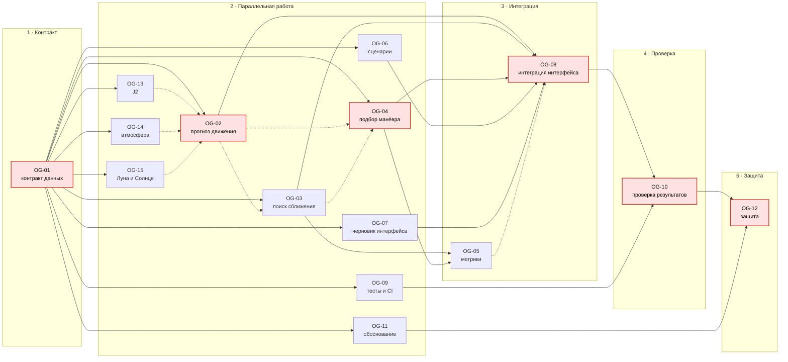

# Распределение работы

Как пять участников работают параллельно. Что такое каждая задача — в [PLAN.md](PLAN.md),
критерии готовности — в [BACKLOG.md](BACKLOG.md).

## Схема зависимостей

Сплошная стрелка — нельзя начать без предыдущей задачи.
Пунктир — можно начать раньше, но проверить с реальным кодом только после неё.
Красным — критический путь: его задержка сдвигает всю работу.



## Темы

Кто какую тему берёт, команда решает сама. Тему «Силы» берёт дополнительно тот, у кого меньше нагрузки в начале.

| Тема | Задачи | Свои файлы | Что делать, пока ждёшь других |
|---|---|---|---|
| Модель орбит и контракт | OG-01, OG-02, OG-13 | `models.py`, `propagation.py`, `forces/gravity.py`, `docs/contracts.md` | Ничего — стартует первой |
| Силы | OG-14, OG-15 | `forces/drag.py`, `forces/third_body.py`, `atmosphere.py`, `ephemeris.py` | Писать и тестировать силы отдельно от прогноза |
| Сближения и метрики | OG-03, OG-05 | `conjunction.py`, `metrics.py` | Тестировать на прямолинейном движении r(t) = r0 + v·t |
| Манёвр и обоснование | OG-04, OG-11 | `maneuver.py`, `docs/feasibility.md` | Писать перебор с временной функцией прогноза; обоснование — сразу |
| Интерфейс | OG-07, OG-08 | `app.py` | Делать страницу на тестовых данных из OG-01 |
| Сценарии, тесты и защита | OG-06, OG-09, OG-10, OG-12 | `scenarios.py`, `.github/`, `tests/integration/`, `docs/validation.md` | Настроить CI и каркас тестов |

## Нагрузка и риски

| Риск | Что делаем |
|---|---|
| Все ждут модель орбит в начале | Вместе с OG-01 выложить простую рабочую версию прогноза, проверки доделать в OG-02 |
| Тема «Сценарии, тесты и защита» перегружена в конце | Сценарии (OG-06) может взять тема «Модель орбит» после OG-02 |
| Интерфейс ждёт расчёт | До интеграции работает на тестовых данных |
| Сила не успевает пройти проверки | Остаётся выключенной, переносится в «развитие» |

## Порядок работ по темам

| Этап | Модель орбит | Силы | Сближения | Манёвр | Интерфейс | Сценарии и защита |
|---|---|---|---|---|---|---|
| 1. Контракт | OG-01 | ревью OG-01 | ревью OG-01 | ревью OG-01, старт OG-11 | макет страницы | каркас тестов |
| 2. Параллельно | OG-02, OG-13 | OG-14, OG-15 | OG-03 | OG-04 | OG-07 | OG-09, OG-06 |
| 3. Интеграция | подключение сил | ревью | OG-05 | OG-04 на реальном прогнозе | OG-08 | тесты интеграции |
| 4. Проверка | исправления | исправления | исправления | OG-11 | экспорт, скриншоты | OG-10 |
| 5. Защита | ответы по физике | ответы по силам | ответы по сближениям | бизнес и БРИКС | демо | OG-12 |

Каждый готовит слайд и ответы на вопросы по своей теме.

## Правила

| Правило | Зачем |
|---|---|
| Код алгоритмов — только после влития OG-01 | Все пишут под одни форматы |
| Контракт меняется только через issue OG-01 | Никто не ломает чужой код молча |
| Один issue — одна ветка — один небольшой PR | Легко ревьюить и вливать |
| Чужие файлы не правим | Нет конфликтов в Git |
| Тестовые данные помечены | Не выдаём заглушки за расчёт |

## Промпт для агента участника

Ветка — своя или с коротким названием по сути задачи.

```text
Работаем в github.com/orbitguard-team/orbitguard.
Прочитай START_HERE.md и AGENTS.md. Выполни назначенный мне issue #N.
Проверь обсуждение и зависимости, создай свою ветку от main,
выполни критерии задачи и нужные проверки, открой PR с Closes #N
и запроси ревью у другого участника. Не делай merge.
```
